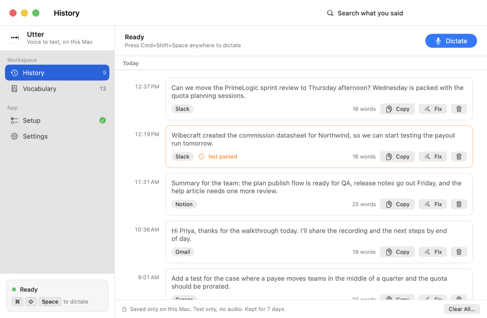
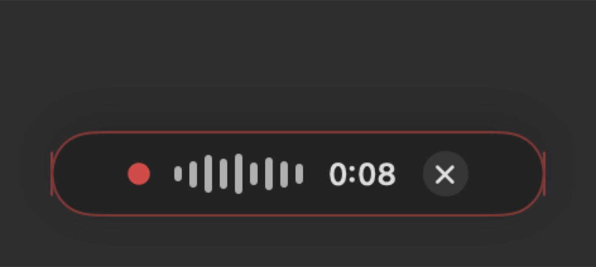
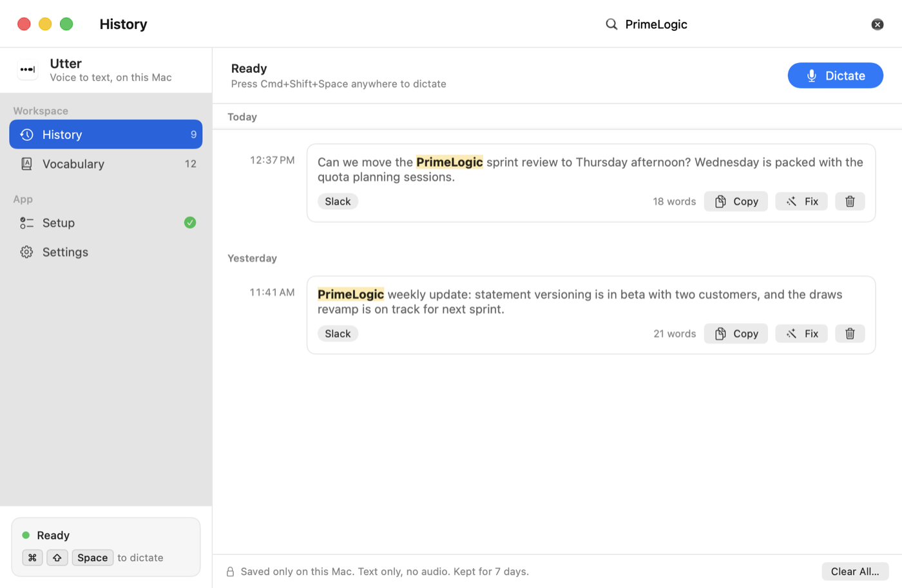
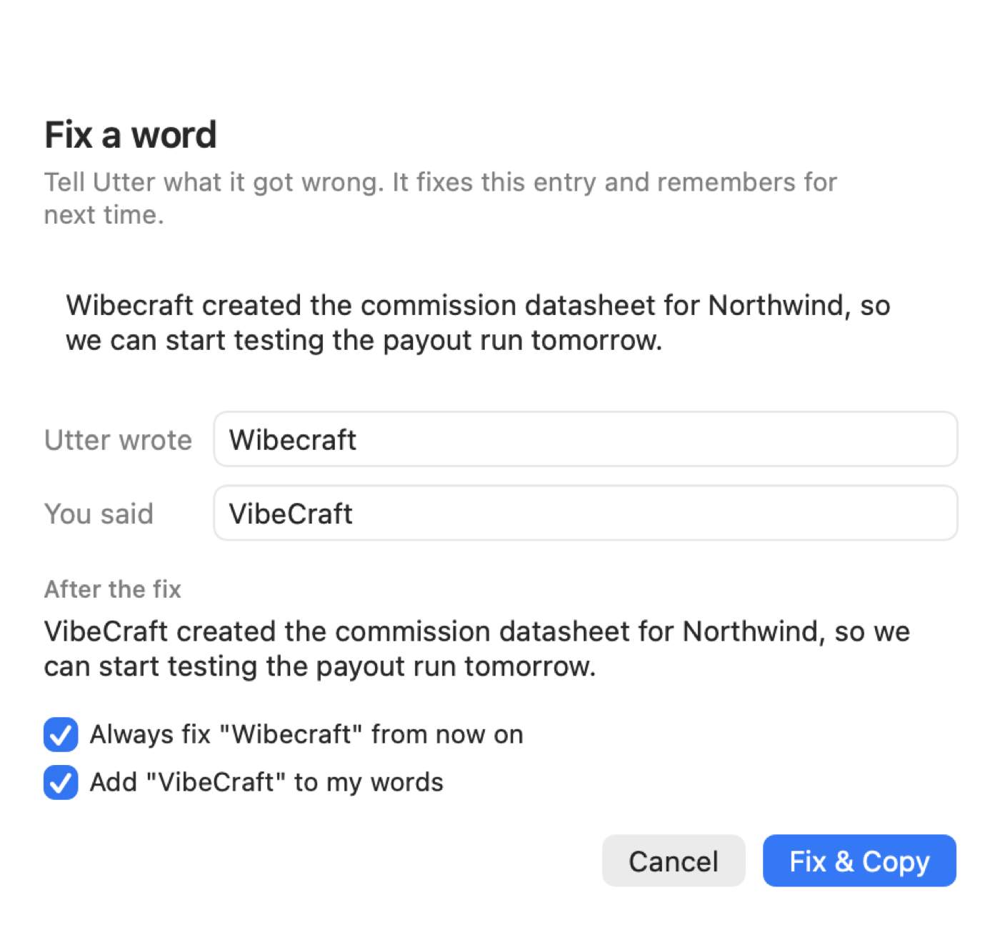

# Utter

Voice to text for Mac. Press **Cmd+Shift+Space**, speak, and your words are typed wherever your cursor is: Slack, email, docs, the terminal, anywhere.

Speech is turned into text on your Mac with OpenAI's Whisper model. No subscription, no usage limits, and your audio never leaves your machine.



> **Utter was called Evertalk** until version 3.0. Already have Evertalk? See [Coming from Evertalk](#coming-from-evertalk): you click Update once and your speech model comes with you.

## Install

```bash
brew trust --tap ram902-bot/tap
brew install --cask ram902-bot/tap/utter
```

The first line tells Homebrew you trust this tap; newer Homebrew versions refuse to install from taps you haven't trusted. If Homebrew says `trust` is an unknown command, your version doesn't need it: just run the second line.

Don't have Homebrew? Install it from [brew.sh](https://brew.sh) first.

> **Everstage laptops:** open **Everstage Self Service**, search **Make Me Admin** and run it before installing. You need it again to switch on Accessibility.

### First launch

Utter opens a short setup checklist. Each step ticks green as soon as it's done:

1. **Allow the microphone** so Utter can hear you.
2. **Allow Accessibility** so Utter can type into the app you're using. On a company Mac, run Make Me Admin first.
3. **Speech model** downloads once (about 490 MB). You can carry on with the other steps meanwhile.
4. **Try it**: click into any text box, press Cmd+Shift+Space, say a sentence, press it again.

You can reopen this checklist any time from **Setup** in the sidebar. It shows a green tick when everything is working.

## How to use it

1. Click into any text field.
2. Press **Cmd+Shift+Space** and start talking.
3. Press **Cmd+Shift+Space** again when you're done.
4. The text appears where your cursor was, usually within 1-2 seconds.

You can also click **Dictate** in the Utter window, or click the floating indicator.

### The floating indicator

A small pill at the bottom of your screen shows what Utter is doing. It stays dark in light and dark mode.

| State | Looks like |
|---|---|
| Ready | A thin line. Hover to see the mic, click to start |
| Listening | Red dot, live voice level, timer, and an **X** to cancel |
| Transcribing | Spinner, "Transcribing..." |
| Done | "Pasted", or "Copied - press Cmd+V" if the text couldn't be typed in (click it to open History) |



Drag it anywhere. Turn it off or reset its position in Settings.

## History

Every dictation is saved on your Mac, so nothing is lost if a paste fails.

- **Search** what you said. Matching words are highlighted.
- **Copy** any entry again, **Fix** a wrong word, or **delete** it.
- Entries that couldn't be typed in are marked **Not pasted**.
- Kept for 7 days by default. Choose 1, 7, 30 or 90 days, or until you delete it, in Settings. Turning history off deletes it.



## Vocabulary: teach Utter your words

Product names, people, acronyms and code terms often come out wrong. Teach Utter once and it spells them right from then on.

1. **Fix words as you go.** In History, click **Fix** on an entry, type what Utter wrote and what you said. Utter corrects the entry, copies it, and remembers the fix.
2. **Import your work words.** On the Vocabulary page, click **Import .md File...** and pick a glossary, README or notes file. Utter picks out names and terms, and you untick anything you don't want.



How it works: your words are given to the speech model as a hint before it listens, so it leans towards those spellings. Saved fixes are then applied to the text, every time, to whole words only. In a test with jargon-heavy sentences, 11 of 11 terms came out right with a vocabulary, against 7 of 11 without.

## Updates

Utter checks for a new version when it opens, every 6 hours, and when you come back to it. When one is out you'll see a notification and a banner on the History page. Click **Update Now**: Utter updates through Homebrew and reopens.

To update by hand:

```bash
brew upgrade --cask utter
```

After an update, macOS may switch off Utter's Accessibility access. The Setup page shows an orange mark if it does.

## Privacy

- **Your audio never leaves your Mac.** Recording and transcription both happen on-device. Audio is never saved.
- **Your history and vocabulary stay on your Mac**, in `~/Library/Application Support/Utter`, readable only by your Mac account.
- **Anonymous usage counts.** Utter tells its maintainer how many people install it and use it each week. It sends a random ID, the Utter version and the macOS version when you first open Utter, after your first dictation, and at most once a week after that. Never your name, what you say, your history or your words. Switch it off in Settings > Privacy.
- **The internet is also used to** download the speech model once from Hugging Face and check GitHub for updates.
- **Open source.** Read the code in this repo.

## Coming from Evertalk

Evertalk is now Utter. Updating keeps your speech model and settings, so there's no second download.

### What's called what

| | Name |
|---|---|
| The app you have today | **Evertalk** (menu bar mic icon) |
| The Homebrew package you update | **`evertalk`**, kept so your existing update button finds it |
| The app after updating | **Utter**, in `/Applications/Utter.app`. Evertalk is removed |
| New installs | `brew trust --tap ram902-bot/tap` then `brew install --cask ram902-bot/tap/utter` |

### How to update

Nothing updates by itself. You click Update or run one command.

1. **Everstage laptop?** Open **Everstage Self Service**, search **Make Me Admin** and run it. Without admin rights the update fails with "Update failed - retry".
2. **Update**, depending on your version (Evertalk menu bar > Settings shows it):
   - **Evertalk 2.2.2 or 2.2.3:** click the mic icon in the menu bar, then **Update to 3.0.1...**. This can take up to 6 hours to appear after release; reopening Evertalk checks again.
   - **Evertalk 2.2.0 or 2.2.1:** there's no update button. Run this in Terminal:

     ```bash
     brew upgrade --cask evertalk
     ```

3. **Utter opens by itself.** Evertalk is gone and Utter is in Applications.
4. **Allow the microphone and Accessibility again.** macOS treats Utter as a new app, so the setup checklist asks for both once. On an Everstage laptop, run Make Me Admin again if Accessibility won't switch on.

After this, Utter keeps itself up to date. It shows a notification and a banner when a new version is out, and moves you to the `utter` package on its next update.

### If something's off after updating

- **The shortcut does nothing:** Evertalk is probably still running. Utter shows **Quit Evertalk**; click it.
- **Text doesn't appear, but Cmd+V pastes it:** Accessibility isn't on for Utter yet. Open **Setup** in the sidebar and follow step 2.
- **"Update failed - retry" in Evertalk:** run Make Me Admin, then click it again.

## Troubleshooting

| Problem | Fix |
|---|---|
| Text doesn't appear, but Cmd+V pastes it | Accessibility is off. Open **Setup** in the sidebar and follow step 2. On a company Mac, run Make Me Admin first. If Utter is already switched on, switch it off and on again. |
| The shortcut does nothing | Check **Setup**. If the old Evertalk app is running, click **Quit Evertalk**. If another app uses Cmd+Shift+Space, change that app's shortcut. |
| A word keeps coming out wrong | Click **Fix** on that entry in History. Utter fixes it from then on. |
| "Didn't catch that" | Speak for at least a second before stopping, close to the mic. Utter understands English only. |
| Update didn't finish | On a company Mac, run Make Me Admin, then click **Try Again**. |
| Model download stuck | On a VPN or corporate proxy downloads can be slow. Click **Retry** on the Setup page; finished parts are kept. |

To see detailed logs, run the app from Terminal:

```bash
/Applications/Utter.app/Contents/MacOS/Utter
```

## Under the hood

- Native SwiftUI app for macOS 14+ on Apple Silicon.
- [WhisperKit](https://github.com/argmaxinc/WhisperKit) runs Whisper on the Neural Engine with Core ML.
- Model: Whisper small.en (English), about 490 MB, stored in `~/Library/Application Support/Utter/models`.
- The logo is the letter U in Morse code (dot, dot, dash), followed by a text cursor.

### Build from source

```bash
git clone https://github.com/Ram902-bot/utter.git
cd utter
xcodegen generate   # regenerates Utter.xcodeproj from project.yml
open Utter.xcodeproj
```

Requires Xcode 15+ and macOS 14+. `./deploy.sh` installs the latest Debug build.

To regenerate the screenshots in `docs/screenshots`, see [docs/SCREENSHOTS.md](docs/SCREENSHOTS.md).

## License

MIT License. See [LICENSE](LICENSE).

- [WhisperKit](https://github.com/argmaxinc/WhisperKit): MIT License
- [Whisper](https://github.com/openai/whisper): MIT License

Built by Ram. Side project, not an official Everstage tool.
